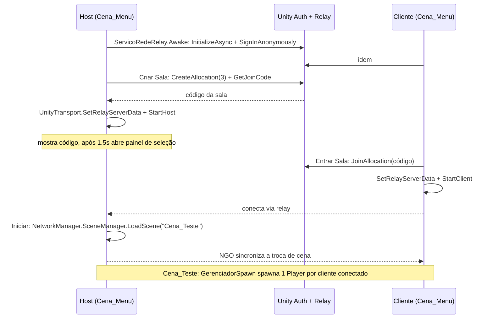
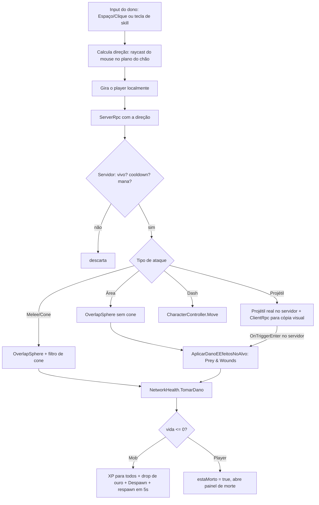

# Breakthrough

Protótipo de **Action RPG multiplayer co-op top-down (câmera isométrica)** feito em **Unity 6**. Até 4 jogadores entram numa sala pela nuvem (Unity Relay, sem servidor dedicado), enfrentam mobs melee/ranged, ganham XP, sobem de nível, coletam ouro e usam skills com uma mecânica de sinergia chamada **Prey & Wounds**.

> O projeto Unity fica dentro da pasta [`My project/`](My%20project/). Abra **essa** pasta no Unity Hub, não a raiz do repositório.

---

## Sumário

1. [Stack e infraestrutura](#stack-e-infraestrutura)
2. [Como rodar](#como-rodar)
3. [Estrutura de pastas](#estrutura-de-pastas)
4. [Arquitetura de rede](#arquitetura-de-rede)
5. [Fluxos do jogo](#fluxos-do-jogo)
6. [Fórmulas e balanceamento](#fórmulas-e-balanceamento)
7. [Dados configuráveis (ScriptableObjects)](#dados-configuráveis-scriptableobjects)
8. [Mapa de cenas e prefabs](#mapa-de-cenas-e-prefabs)
9. [Referência de scripts](#referência-de-scripts)
10. [Controles](#controles)
11. [Pontos de atenção e dívidas técnicas](#pontos-de-atenção-e-dívidas-técnicas)

---

## Stack e infraestrutura

| Item | Versão / valor |
|---|---|
| Engine | Unity **6000.6.7f1** |
| Render | URP 17.6.0 (perfis `PC_RPAsset` e `Mobile_RPAsset` em `Assets/Settings`) |
| Rede | Netcode for GameObjects (NGO) **2.14.0** + Unity Transport (UTP) |
| Conexão online | Unity Gaming Services: **Relay 1.2.0** + **Authentication** (login anônimo) |
| Input | Input System 1.20.1 (leitura direta de `Keyboard.current` / `Mouse.current`) |
| UI | uGUI + TextMesh Pro |
| Testes multiplayer locais | Multiplayer Play Mode 3.0.0 |
| Outros pacotes | Unity AI Assistant / AI Inference (ferramentas de editor, não usados em runtime) |
| IDE | VS Code (`.vscode/launch.json` com "Attach to Unity") ou Rider |

**Não há backend próprio, banco de dados nem CI.** Toda a infraestrutura online é o Unity Relay: o jogador que cria a sala vira **Host** (servidor + cliente), e os demais conectam a ele através do relay da Unity usando um código de sala.

O projeto está vinculado a um projeto Unity Cloud (`cloudProjectId` em `ProjectSettings/ProjectSettings.asset`). Sem esse vínculo, o Relay não funciona.

---

## Como rodar

### Primeira vez após clonar

1. Instale o Unity **6000.6.7f1** pelo Unity Hub.
2. No Hub: **Add → Add project from disk** → selecione `Breakthrough/My project`.
3. Ao abrir, importe os recursos do TextMesh Pro: **Window → TextMeshPro → Import TMP Essential Resources**. A pasta `Assets/TextMesh Pro/` está no `.gitignore` e não vem no clone.
4. Confirme o vínculo com Unity Cloud em **Edit → Project Settings → Services**. Faça login com uma conta que tenha acesso à organização do projeto. Sem isso, criar/entrar em sala falha.

### Jogando

1. Abra `Assets/_Project/Scenes/Cena_Menu.unity` e dê Play. **O jogo precisa começar pelo menu**: a `Cena_Teste` sozinha não inicia a rede.
2. Clique em **Criar Sala**. Um código de sala aparece na tela.
3. Para um segundo jogador:
   - **No mesmo PC:** use **Window → Multiplayer → Multiplayer Play Mode** e ative um Virtual Player.
   - **Em outro PC:** gere um build ou abra o projeto lá.
4. No segundo jogador, digite o código e clique em **Entrar Sala**.
5. No host, clique em **Iniciar**. O host carrega a `Cena_Teste` para todos.

---

## Estrutura de pastas

```
Breakthrough/
└── My project/                         ← projeto Unity
    ├── Assets/
    │   ├── _Project/                   ← todo o conteúdo do jogo
    │   │   ├── Data/
    │   │   │   ├── PreyWounds/Prey1.asset     (config de Prey & Wounds)
    │   │   │   └── Skills/Skill 1.asset       (skill "Marca do caçador")
    │   │   ├── Prefab/                 Player, Mob, Gold, ProjetilCombate, Skill1
    │   │   ├── Scenes/                 Cena_Menu, Cena_Teste
    │   │   └── Scripts/
    │   │       ├── Combat/             skills, Prey & Wounds
    │   │       ├── Conexão/            rede, Relay, spawn, vida, respawn, projétil, UI de morte
    │   │       ├── Dropeloot/          drop de loot dos mobs
    │   │       ├── Mobs/               IA e spawner de mobs
    │   │       └── Player/             movimento, ataque, stats, inventário, HUD, câmera, coleta
    │   ├── _Recovery/0.unity           cena antiga de recuperação (legado, ver "Pontos de atenção")
    │   ├── Settings/                   assets do URP
    │   ├── DefaultNetworkPrefabs.asset lista de prefabs de rede (Player, Mob, Gold)
    │   └── InputSystem_Actions.inputactions  (padrão do template, não usado pelos scripts)
    ├── Packages/manifest.json
    └── ProjectSettings/
```

---

## Arquitetura de rede

O modelo é **servidor autoritativo** (o Host decide tudo), com uma exceção: o **movimento do jogador é autoritativo do dono**.

| Aspecto | Quem decide | Como |
|---|---|---|
| Movimento do Player | **Cliente dono** | `NetworkTransform` com `AuthorityMode: Owner` |
| Movimento dos Mobs | Servidor | `NetworkTransform` com `AuthorityMode: Server` |
| Vida, mana, XP, nível, atributos, ouro | Servidor | `NetworkVariable` com escrita só no servidor |
| Ataques e skills | Servidor | Cliente envia `ServerRpc` com a direção do mouse; servidor valida cooldown/mana e aplica dano |
| Projéteis | Servidor (hit) / todos (visual) | **Não são NetworkObjects.** O servidor cria a cópia "real" que aplica dano; um `ClientRpc` cria cópias só visuais nos clientes. Cada projétil acerta no máximo um alvo (`jaAcertou`), atravessa cadáveres e triggers sem vida, e para em paredes |
| Spawn de Player | Servidor | `GerenciadorSpawn` chama `SpawnAsPlayerObject` |
| Spawn de Mobs e loot | Servidor | `MobSpawner` e `MobLoot` com `NetworkObject.Spawn` |

Padrão usado nos scripts:
- `if (!IsOwner) return;` no `Update` para ler input só no dono.
- `if (!IsServer) return;` em toda lógica de jogo (IA, regen, dano).
- RPCs no estilo novo do NGO 2.x: `[Rpc(SendTo.Server, InvokePermission = ...)]` e `[Rpc(SendTo.Owner)]`. Alguns scripts (`PlayerAtaque`, `PlayerSkills`, `MobCombat`, `PlayerInventory`) ainda usam o atributo legado `[ClientRpc]`.
- `NetworkHealth.TomarDano` ignora valores `<= 0`, para que um dano negativo não cure o alvo.
- Buffers pré-alocados (`OverlapSphereNonAlloc`, `RaycastNonAlloc`) para evitar garbage collection.

---

## Fluxos do jogo

### 1. Conexão: Menu → Relay → Partida



Detalhes:
- `ServicoRedeRelay` e o `NetworkManager` do menu ficam em `DontDestroyOnLoad`, então sobrevivem à troca de cena. O `PersistirRede` é um singleton: se o jogador voltar ao menu, a cópia nova do NetworkManager é destruída.
- O login começa em segundo plano no `Awake` (`GarantirLogin`). Criar e Entrar esperam por ele, e uma tentativa que falhou é refeita no próximo clique.
- Há uma trava (`ocupado`) contra duplo clique em Criar/Entrar. Também há uma checagem que recusa criar ou entrar em sala se a rede já estiver ligada (`IsListening`).
- O `NetworkManager` precisa ter o componente `UnityTransport`; se faltar, o serviço só registra um erro.
- A sala aceita **4 jogadores** (host + 3), definido em `CriarSalaRelay(int maximoJogadores = 4)`.
- O código digitado passa por `Trim()` e é convertido para maiúsculas antes do join.
- O botão **Iniciar** só funciona no host. No cliente, ele mostra "Aguardando o Host iniciar o jogo...". Sem sala, mostra "Crie ou entre em uma sala antes de iniciar."
- O botão "Desconectar / Menu" só existe no `ConexaoUI` (legado), não está na `Cena_Teste`.

### 2. Spawn do jogador

1. `GerenciadorSpawn.Start` (só no servidor) assina `OnClientConnectedCallback` e spawna players para todos os clientes já conectados.
2. Antes de instanciar, verifica se o cliente já tem um `PlayerObject` em `ConnectedClients`, para evitar duplicata.
3. Instancia `Player.prefab` no `PlayerSpawnPoint`, deslocado em X por `(clientId % 4) × 1.5`, e chama `SpawnAsPlayerObject(clientId)`. Sem ponto configurado, usa `(0, 1, 0)` como base. O `GerenciadorSpawn` é o único que decide a posição inicial.
4. `NetworkHealth` guarda o player local em `NetworkHealth.PlayerLocal` e dispara `OnPlayerLocalSpawnou`. O `GerenciadorUI` usa os dois, então funciona mesmo se o player nascer antes da UI.
5. `CameraSegue` procura o player **desta** tela com `SpawnManager.GetLocalPlayerObject()`, a cada 0.25s até achar. Ao achar, posiciona a câmera direto nele. Depois segue com offset `(0, 12, -8)` e suavização exponencial, que não muda com o FPS. A rotação da câmera vem da cena, não do script.

### 3. Loop de combate



**Ataque básico** (`PlayerAtaque`):
- Cooldown de 0.4s no cliente. O servidor também controla o intervalo, com 10% de folga para lag, e descarta direções inválidas (inclusive NaN). Não atinge outros jogadores (sem friendly fire).
- **Melee:** atinge **um único** alvo, o mob mais próximo dentro de um cone de 120° e raio 3. Escala com Força. A busca usa o `LayerMask` `camadaAlvos` (marque só a layer dos mobs) e `GetComponentInParent`, então funciona com colliders em objetos filhos.
- **Ranged:** dispara um projétil. Escala com Agilidade. **O prefab do Player está configurado como Ranged.**

**Skills** (`PlayerSkills`):
- 5 slots, com cooldown validado no cliente (para feedback) e de novo no servidor (autoridade).
- A mana é checada no cliente e gasta no servidor (`PlayerStats.GastarMana`).
- O Dash move o personagem no cliente na hora, para resposta instantânea.
- Hoje só o **slot 0** tem skill equipada ("Marca do caçador").

### 4. Prey & Wounds (sinergia de skills)

Componente `StatusPreyWounds` presente em Mob e Player, configurado por `PreyWoundsData`.

- **Prey** (marca da presa): o alvo marcado recebe ×1.25 de dano por 8s.
- **Wounds** (ferimentos): stacks de 0 a 5. Cada stack dá +5 de dano fixo. Os stacks somem 6s após o último acerto.
- **Ruptura:** uma skill com `consomeWoundsParaExplodir` estoura todos os stacks e causa 35 de dano por stack (×1.25 se o alvo tiver Prey).

A ordem dentro de `PlayerSkills.AplicarDanoEEfeitosNoAlvo` é:
1. Calcula o dano já com os modificadores atuais de Prey e Wounds.
2. Aplica a nova marca de Prey e/ou os novos Wounds.
3. Aplica o dano.
4. Se a skill consome Wounds e o alvo ainda está vivo, executa a Ruptura.

### 5. IA dos mobs

`MobCombat` roda só no servidor, a cada frame:
1. Procura o player vivo mais próximo num raio de 15 (`OverlapSphereNonAlloc` filtrando por `PlayerMovimento`).
2. Gira para olhar o alvo.
3. Movimenta conforme o estilo:
   - **Melee:** avança até ficar no alcance.
   - **Ranged (kiting):** recua se o player estiver a menos de 4, avança se estiver longe demais.
4. Ataca respeitando `intervaloAtaque`: dano direto (melee) ou projétil (ranged).

O movimento é feito por `transform.position` com raycast para baixo para "grudar" no chão. **Não usa NavMesh.** Se não houver chão na posição futura, o mob não se move, o que impede que ele caia da plataforma.

O `Mob.prefab` está configurado como **Ranged**, com 100 de vida, 10 de dano e 40 de XP.

### 6. Morte do mob, XP e loot

1. `NetworkHealth.Morrer()` marca `estaMorto` com trava contra chamada dupla.
2. **XP:** os 40 de XP vão para **todos** os players conectados, independente de distância.
3. **Loot (`MobLoot`):** faz raycast para achar o chão, spawna 1 `Gold` e tem 30% de chance de spawnar uma espada. O `prefabEspada` está vazio, então hoje a espada nunca cai.
4. Dispara `OnMobMorreu`. O `MobSpawner` agenda um novo mob em 5s.
5. `NetworkObject.Despawn(true)`.

O `MobSpawner` mantém 3 mobs num raio de 8 em torno de si e só começa quando o servidor está ativo, com trava contra spawn duplicado.

### 7. Coleta de ouro

1. `ItemCoativel` (no `Gold.prefab`) desce suavemente até o chão mais próximo ao spawnar.
2. Quando o player **dono local** encosta no trigger, o cliente só avisa o servidor com `SolicitarColetaServerRpc()`, no máximo uma vez a cada 0.5s.
3. O servidor valida o pedido: o remetente precisa ter um player, estar vivo e estar a até 4 de distância do item (posição conhecida pelo servidor). O item só pode ser coletado uma vez.
4. O servidor chama `PlayerInventory.AdicionarOuro(10)`. A quantidade vem do item, nunca do cliente. Depois despawna o item.

O inventário (`PlayerInventory`) guarda o ouro numa `NetworkVariable<int>` e os itens numa `NetworkList<FixedString128Bytes>` que só o dono recebe. `AdicionarOuro` e `AdicionarItem` são métodos comuns que só funcionam no servidor; não são RPCs.

### 8. Progressão (nível, atributos, mana)

- Tudo vive em `PlayerStats` como `NetworkVariable` escrita pelo servidor.
- Ao subir de nível: +1 em FOR, AGI, INT e VIT. A vida e a mana máximas são recalculadas e totalmente restauradas.
- A mana regenera a cada 2.5s (só no servidor, só com o player vivo).
- Ao respawnar, a mana volta ao máximo.

### 9. Morte e respawn do jogador

1. A vida chega a 0, então `estaMorto = true`. Movimento, ataque e skills são bloqueados.
2. No dono, `NetworkHealth.OnEstadoMorteLocalMudou` faz o `GerenciadorUI` abrir o `PainelMorte`.
3. O botão **Respawn** chama `SolicitarRespawnServerRpc`. Só o dono do personagem pode chamar (`InvokePermission.Owner`), e o servidor ignora o pedido se o player não estiver morto.
4. O servidor restaura a vida, zera `estaMorto` e pega a posição no `RespawnManager`. A ordem de busca é: o campo do Inspector, depois o objeto `PontoRespawn` na cena (buscado uma vez e guardado), e por último `(0,1,0)`.
5. O servidor teleporta o player e envia `TeleportarClienteRpc` (`SendTo.Owner`) para o dono se teleportar, já que o movimento é autoritativo do dono.

### 10. HUD

`GerenciadorHUD` busca o player local via `SpawnManager.GetLocalPlayerObject()` e só se vincula quando o player tem `NetworkHealth`, `PlayerStats` e `PlayerInventory`. Lê os valores todo frame, mas só reescreve um texto quando o valor muda. A lista de itens é redesenhada via evento `OnInventarioAtualizado`.
- Sempre visível: Vida, Mana, Nível/XP.
- Alterna com **I** ou **Tab**: atributos, ouro e itens. Começa aberto.

---

## Fórmulas e balanceamento

| O quê | Fórmula | Onde |
|---|---|---|
| Dano do ataque básico | `max(1, danoBase(25) + (atributo − 10) × 3)` (FOR se melee, AGI se ranged) | `PlayerAtaque.CalcularDanoFinal` |
| Dano de skill | `danoBase + (atributo − 10) × bonusPorPontoAtributo` | `PlayerSkills.CalcularDanoSkill` |
| Modificador Prey & Wounds | `(dano + wounds × 5) × 1.25 se Prey` | `StatusPreyWounds.CalcularDanoModificado` |
| Ruptura | `stacks × 35 × 1.25 se Prey` | `StatusPreyWounds.ConsumirTodosWounds` |
| Vida máxima | `100 + (VIT − 10) × 15` | `PlayerStats.RecalcularAtributosDerivados` |
| Mana máxima | `50 + (INT − 10) × 10` | idem |
| Regen de mana | `1 + max(0, (INT − 10) / 5)` a cada 2.5s | `PlayerStats.Update` |
| XP para o próximo nível | começa em 100, vira `round(anterior × 1.25)` a cada nível | `PlayerStats.SubirDeNivel` |
| Atributos iniciais | FOR/AGI/INT/VIT = 10 | `PlayerStats` |

---

## Dados configuráveis (ScriptableObjects)

Crie novos pelo menu **Create → Combate → ...**

### `SkillData` (Create → Combate → Skill Data)

| Campo | Uso |
|---|---|
| `nomeSkill`, `descricao` | Identificação |
| `custoMana`, `cooldown` | Custo e recarga |
| `tipoExecucao` | `GolpeConeMelee`, `AreaAoRedor`, `DisparoProjetil`, `DashPosicionamento` |
| `atributoEscala` | `Forca`, `Agilidade`, `Inteligencia` |
| `danoBase`, `bonusPorPontoAtributo` | Dano |
| `alcanceOuRaio`, `anguloCone` | Área (cone e área) |
| `prefabProjetil`, `velocidadeProjetil` | Projétil (o prefab precisa ter `ProjetilCombate`) |
| `distanciaDash` | Dash |
| `aplicaPrey`, `woundsParaAplicar`, `consomeWoundsParaExplodir` | Sinergia Prey & Wounds |

Skill existente, **"Marca do caçador"** (`Data/Skills/Skill 1.asset`): projétil, escala com AGI, 10 de mana, cooldown de 3s, 40 de dano base (+4 por ponto), aplica Prey, aplica 1 Wound e consome os Wounds.

### `PreyWoundsData` (Create → Combate → Prey & Wounds Data)

`Prey1.asset`: Prey dura 8s com ×1.25; máximo de 5 Wounds; Wounds duram 6s; +5 de dano por Wound; Ruptura de 35 por stack; `estourarAoAtingirMaximo = false`.

---

## Mapa de cenas e prefabs

### Cenas

| Cena | Objetos principais | Scripts |
|---|---|---|
| **Cena_Menu** (ponto de entrada) | `Network` (NetworkManager + UnityTransport), `Servicos`, `GerenciadorMenu`, Canvas com `PainelTitulo` e `PainelSelecao` | `PersistirRede`, `ServicoRedeRelay`, `MenuPrincipalUI` |
| **Cena_Teste** (gameplay) | `NetworkManager`, `Ground`, `Mobspawner`, `PlayerSpawnPoint`, `PontoRespawn`, `Main Camera`, Canvas `HUD` / `PainelMorte` | `GerenciadorSpawn`, `RespawnManager`, `MobSpawner`, `CameraSegue`, `GerenciadorHUD`, `GerenciadorUI` |
| `_Recovery/0.unity` (legado) | Versão antiga com conexão por IP | `ConexaoUI`, `MobSpawner`, `CameraSegue` |

### Prefabs (todos em `Assets/_Project/Prefab/`)

| Prefab | Componentes | Rede |
|---|---|---|
| **Player** (tag `Player`) | `CharacterController`, `NetworkObject`, `NetworkTransform` (Owner), `PlayerMovimento`, `PlayerAtaque` (Ranged), `PlayerSkills`, `PlayerStats`, `PlayerInventory`, `NetworkHealth`, `StatusPreyWounds` | NetworkPrefab |
| **Mob** | `NetworkObject`, `NetworkTransform` (Server), `MobCombat` (Ranged), `NetworkHealth` (`ehMob`), `MobLoot`, `StatusPreyWounds` | NetworkPrefab |
| **Gold** | `NetworkObject`, `ItemCoativel` (trigger) | NetworkPrefab |
| **ProjetilCombate** | `ProjetilCombate` (trigger) | Local (não é de rede) |
| **Skill1** | `ProjetilCombate` (trigger) | Local (não é de rede) |

---

## Referência de scripts

| Script | Tipo | Responsabilidade |
|---|---|---|
| `Conexão/ServicoRedeRelay` | MonoBehaviour, singleton, persistente | Inicializa UGS, faz login anônimo, cria e entra em salas do Relay, inicia Host/Client |
| `Conexão/MenuPrincipalUI` | MonoBehaviour | Botões do menu: criar sala, entrar sala, iniciar jogo |
| `Conexão/PersistirRede` | MonoBehaviour | `DontDestroyOnLoad` no NetworkManager do menu |
| `Player/GerenciadorSpawn` | MonoBehaviour, singleton | Spawna um Player por cliente conectado e decide a posição inicial. Há uma cópia antiga em `Conexão/` (ver "Pontos de atenção") |
| `Conexão/NetworkHealth` | NetworkBehaviour | Vida e morte de players e mobs, XP e loot do mob, RPC de respawn |
| `Conexão/RespawnManager` | MonoBehaviour, singleton | Resolve a posição de respawn |
| `Conexão/GerenciadorUI` | MonoBehaviour | Painel de morte e botão de respawn |
| `Conexão/ProjetilCombate` | MonoBehaviour | Movimento do projétil; aplica dano só na cópia do servidor |
| `Conexão/DadosSessao` | static | Dados entre cenas (host/cliente, IP, porta, classe). Usado só pelo `ConexaoUI` legado |
| `Conexão/ConexaoUI` | MonoBehaviour | **Legado:** conexão direta por IP com UI em `OnGUI`. Não reinicia a rede se ela já estiver ligada |
| `Player/PlayerMovimento` | NetworkBehaviour | WASD + gravidade com `CharacterController`; `Teleportar()` seguro para a rede |
| `Player/PlayerAtaque` | NetworkBehaviour | Ataque básico melee ou ranged mirado pelo mouse |
| `Player/PlayerStats` | NetworkBehaviour | Nível, XP, atributos, mana e regen |
| `Player/PlayerInventory` | NetworkBehaviour | Ouro (`NetworkVariable`) e itens (`NetworkList`, só o dono recebe). Escrita só no servidor |
| `Player/ItemCoativel` | NetworkBehaviour | Item no chão: queda até o chão e coleta validada no servidor |
| `Player/GerenciadorHUD` | MonoBehaviour | HUD de texto e painel de inventário |
| `Player/CameraSegue` | MonoBehaviour | Câmera seguindo suavemente o player local |
| `Combat/PlayerSkills` | NetworkBehaviour | 5 slots de skill: cooldown, mana, execução e Prey & Wounds |
| `Combat/SkillData` | ScriptableObject | Definição de skill |
| `Combat/StatusPreyWounds` | NetworkBehaviour | Estado de Prey e Wounds no alvo |
| `Combat/PreyWoundsData` | ScriptableObject | Parâmetros de Prey & Wounds |
| `Mobs/MobCombat` | NetworkBehaviour | IA do mob (perseguir, kiting, atacar) |
| `Mobs/MobSpawner` | MonoBehaviour | Mantém N mobs vivos e faz respawn por timer |
| `Dropeloot/MobLoot` | NetworkBehaviour | Drop de ouro e espada ao morrer |

Convenção: código e nomes em **português**. Logs usam prefixo entre colchetes (`[Relay]`, `[Spawner]`, `[Prey & Wounds]`...), o que facilita filtrar no Console.

---

## Controles

| Ação | Tecla |
|---|---|
| Mover | W A S D |
| Ataque básico (mira no mouse) | Espaço ou Clique esquerdo |
| Skill slot 1 a 4 | `1`/`Q`, `2`/`E`, `3`/`R`, `4`/`F` |
| Skill slot 5 | `5` ou Clique direito |
| Abrir/fechar inventário | `I` ou `Tab` |

---

## Pontos de atenção e dívidas técnicas

Itens encontrados na análise do código. Vale conferir antes de evoluir o projeto.

**Erro de compilação (urgente)**
- `GerenciadorSpawn` existe em **dois arquivos**: `Scripts/Conexão/GerenciadorSpawn.cs` e `Scripts/Player/GerenciadorSpawn.cs`. As duas classes têm o mesmo nome no mesmo assembly, o que gera o erro `CS0101` e impede o projeto de compilar. A versão em `Player/` é a mais nova (spawn em `(0,1,0)` sem ponto configurado). Apague a de `Conexão/` mantendo o `.meta` dela, e mova esse `.meta` para `Player/`. Assim a referência do componente na `Cena_Teste` continua funcionando. O arquivo de `Player/` foi commitado sem `.meta`.

**Configuração e build**
- O Build Settings ainda lista `SampleScene.unity`, que não existe. A entrada está desativada e não afeta o build, mas pode ser removida. A `Cena_Menu` é a primeira cena ativa.
- Existe um Build Profile em `Assets/Settings/Build Profiles/Breakthrough.asset` (produto `Breakthrough`, empresa `KayArt`).
- A pasta `UserSettings/` está versionada. Normalmente ela fica fora do git, por ser específica de cada máquina.
- As pastas `Prefab/Mobs`, `Prefab/Player` e `Scripts/Ui` têm só o `.meta` e estão vazias.

**Menu e seleção de personagem**
- Dois botões da `Cena_Menu` chamam `MenuPrincipalUI.SelecionarPersonagem` e `MenuPrincipalUI.ClicarBotaoStart`, métodos que **não existem** no script. Os cliques não fazem nada.
- A seleção de classe (`DadosSessao.IdPersonagemEscolhido`) não está implementada no fluxo do Relay.
- Existem **dois NetworkManagers**: o do menu (persistente, com `PlayerPrefab` vazio) e o da `Cena_Teste` (com `PlayerPrefab = Player`). Vindo do menu, o da `Cena_Teste` é um duplicado; ele não tem `PersistirRede`, então não é destruído por esse script. O spawn real é feito pelo `GerenciadorSpawn`.
- `ConexaoUI`, `DadosSessao` e `_Recovery/0.unity` são do fluxo antigo por IP. Candidatos a remoção.

**Segurança**
- Os RPCs de ouro e respawn, antes abertos a qualquer cliente, já foram corrigidos. Ao criar RPCs novos, siga o mesmo padrão: o cliente só **pede**, o servidor valida (dono, vivo, distância, cooldown) e os valores vêm do servidor, nunca do cliente.

**Gameplay e consistência**
- O ataque básico **melee** chama `TomarDano` direto e ignora Prey & Wounds. O básico **ranged** passa por `AplicarDanoEEfeitosNoAlvo` (aplica os modificadores, mas não adiciona stacks).
- A "Marca do caçador" aplica 1 Wound e logo depois consome todos. Os Wounds dela nunca acumulam: cada acerto gera uma Ruptura de 1 stack.
- A espada nunca dropa (`prefabEspada` vazio no Mob), e nenhum código chama `PlayerInventory.AdicionarItem`. Hoje a lista de itens fica sempre vazia.
- `PlayerStats.GastarMana` retorna `false` quando o custo é `<= 0`. Uma skill com `custoMana = 0` nunca será executada, porque `PlayerSkills` cancela a skill quando `GastarMana` falha.
- O XP do mob vai para todos os players da sala, mesmo os mortos ou distantes.
- No Dash, o servidor também move o player quando não é o dono. Como o `NetworkTransform` do Player é autoritativo do dono, esse movimento do servidor é sobrescrito.
- Os mobs andam sem NavMesh e atravessam obstáculos.

---

## Histórico

| Data | Marco |
|---|---|
| 2026-11-11 | Conexão, movimento WASD sincronizado, combate e loot, morte e respawn, otimização (buffers NonAlloc) |
| 2026-11-12 | Autenticação (UGS + Relay), HUD, "Fundação completa" |
| 2026-11-13 | Robustez da rede (login com nova tentativa, trava de duplo clique, respawn restrito ao dono), câmera seguindo o player local, Build Profile `Breakthrough` |
| 2026-11-13 | Otimização e anti-cheat: coleta validada no servidor, inventário com `NetworkList`, cooldown do ataque no servidor, HUD sem reescrita desnecessária, spawn decidido só pelo `GerenciadorSpawn` |
